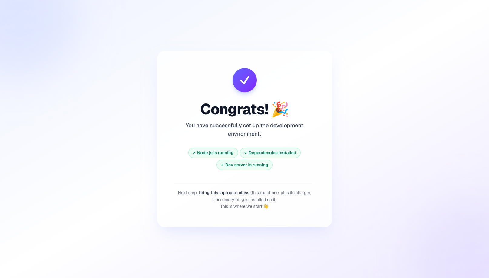

# class-starter · 起步项目（中文版）

[English → README.md](README.md)

如果这个独立的起步项目已经安装好，运行现有项目，确认恭喜页面正常显示，再告诉编程助手你想做什么。

## 运行项目

在这个项目文件夹打开终端，运行：

```bash
npm run dev
```

使用应用时保持终端打开。打开 **http://localhost:3000**；如果终端显示另一个网址，就用它。

按 `Ctrl + C` 停止。要重新启动，在同一个项目文件夹再次运行 `npm run dev`。

## 跑起来后，开始你的项目

看到「Congrats!」页面就表示起步项目运行成功（起步页面是英文的，这是正常的）。



告诉助手你希望用中文沟通，并制作中文的界面、报告和标签，除非你另有要求。

告诉编程助手你想做什么。开始写代码前，助手必须先读现有的 `AGENTS.md`，按照其中的项目探索指引，**一次问一个问题**：项目给谁用、解决什么问题、怎样算成功、主要用手机还是电脑。已经回答的问题不用再问。

## 技术栈

沿用现有项目的写法和 `AGENTS.md` 中的技术栈：**Next.js 16（App Router）+ TypeScript**、**Tailwind + shadcn/ui**、**响应式网页应用**（手机和电脑浏览器都能用，绝不做手机原生 App），以及用于图表的 **recharts**。

## 数据库和登录

按照 `AGENTS.md`，**只用 Supabase CLI**。每个新的数据表都要在同一个 migration 里加 **GRANT + RLS**（2026 年 10 月 30 日起；否则应用会出现错误 `42501`）。登录用 **email + password**，不用 magic link。课堂示范时关闭 email 确认；公司正式使用前，要重新打开，并接上自己的 email 发送服务（custom SMTP）。免费的 Supabase project 大约 7 天没用就会暂停；遇到时在 Supabase 控制台按 **Restore project**。

## 部署

按照 `AGENTS.md`，**只用 Vercel CLI** 部署，例如 `vercel deploy --prod`。不要用 Vercel 插件、连接 GitHub，或通过 Vercel 控制台部署。

用 `vercel env add` 把 key 加成 **Secret** 类型的环境变量，然后重新部署：改动只会用在新的部署。key 只放在电脑上的 `.env.local`，绝不放上 GitHub。

Vercel Hobby（免费）只用于课堂示范。公司正式使用需要 Vercel Pro。

## 常见问题

| 问题 | 解决方法 |
|---|---|
| 页面打不开 | 确认 `npm run dev` 仍在运行，并使用终端显示的网址。 |
| 想停止或重新启动 | 按 `Ctrl + C` 停止；在同一个项目文件夹运行 `npm run dev` 重新启动。 |
| 出现错误或仍然卡住 | 把错误信息交给编程助手或帮助你的人。 |

## 继续这个项目

后续课程或修改继续用同一个项目文件夹和对话。阅读现有的 `AGENTS.md`，了解项目记录和基本规则。
